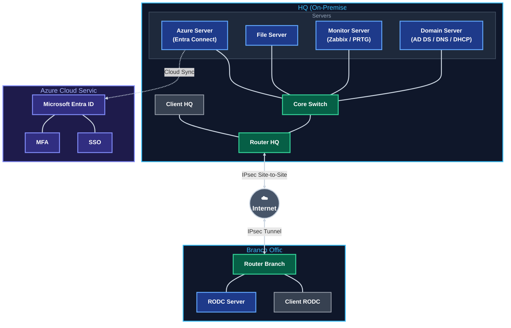

<div align="center">

# ☁️ Hybrid Cloud Lab

**A hybrid enterprise network: HQ ↔ Remote Branch ↔ Azure**

     

[Overview](#-1-project-overview) •
[Technologies](#-2-technologies-used) •
[Design Diagram](#-3-design-diagram) •
[Extension Projects](#-4-extension-projects) •
[Documentation](#-5-detailed-documentation)
</div>

<image src="D:\Hybrid-cloud-github-repo\Hybrid-Cloud-Lab-1\Screenshot\Network-Architecture-Diagram\PROJECT_HYBRIDCLOUD.png">

---

## 📌 1. Project Overview

**Hybrid Cloud Lab** is the central project simulating an enterprise with a headquarters (HQ) and a remote branch, combining on-premises infrastructure with Azure cloud.

| Component | Short description |
|---|---|
| ☁️ **Azure** | Synchronizes on-prem Active Directory to Microsoft Entra ID |
| 🔐 **SSO** | Single sign-on for cloud applications |
| 🛡️ **MFA** | Multi-factor authentication for synchronized accounts |
| 🧩 **VLAN** | Network segmentation by department/function |
| 🔒 **IPsec** | Site-to-site tunnel between HQ and the branch |
| 🌐 **Remote Branch** | Secure connectivity over the Internet to HQ resources |

### 🎯 Goals
- Build a complete, working hybrid enterprise network in a lab environment.
- Fully document the planning, configuration, and operating principles so others can reproduce it.
- Serve as the **root project**; all extension projects branch out from here.

### 📖 Design Documentation (dedicated `docs/` folder)

| Document | Contents |
|---|---|
| [📋 IP Allocation](C:\Users\ThienNguyen\Desktop\HYBRID\Hybrid-Cloud-Lab-1\docs\IP-Allocation) | IP range plan for HQ, branch, and tunnel |
| [🧩 VLAN Configuration](C:\Users\ThienNguyen\Desktop\HYBRID\Hybrid-Cloud-Lab-1\docs\VLAN-Configuration) | VLAN IDs, names, gateways, router/switch configuration |
| [🔒 IPsec Configuration](C:\Users\ThienNguyen\Desktop\HYBRID\Hybrid-Cloud-Lab-1\docs\IPsec-Configuration) | Phase 1/2, algorithms, peers, policies |
| [⚙️ How It Works](C:\Users\ThienNguyen\Desktop\HYBRID\Hybrid-Cloud-Lab-1\docs\how-it-works.md) | Data flow: workstation → VLAN → IPsec → Azure |

---

## 🛠️ 2. Technologies Used

| Category | Technology | Role in the project | Used by |
|---|---|---|---|
| Virtualization | VMware Workstation | Hosts the entire lab environment | Hybrid Cloud |
| Routing / VPN | MikroTik RouterOS | Router, VLAN, IPsec site-to-site | Hybrid Cloud |
| Identity | Windows Server AD | On-prem user management | Hybrid Cloud |
| Cloud | Microsoft Entra ID (Azure) | Identity sync, SSO, MFA | Hybrid Cloud |
| Monitoring | PRTG | Infrastructure status monitoring | Hybrid Cloud |
| IDS | Snort 3 | Intrusion detection | _Extension project_ |
| Log monitoring | Zabbix | Collects and alerts on IDS logs | _Extension project_ |
| ➕ _(add new)_ | | | |

---

## 🗺️ 3. Design Diagram

### Overview



> 💡 Adjust VLAN and device names to match your actual lab.

### Detailed Diagrams

| Diagram | Image |
|---|---|
| Network architecture |  |
| On-premises |  |
| Project flow |  |

---

## 🚀 4. Extension Projects

Projects that grow out of **Hybrid Cloud Lab** (the root project).

**Status legend:** ✅ Success · 🔄 Updating · 📝 Planned

| # | Project | Description | Status | Link |
|---|---|---|---|---|
| 0 | **Hybrid Cloud Lab** (root) | VLAN + IPsec + Azure SSO/MFA | 🔄 Updating | [View](./) |
| 1 | IDS Monitoring | Snort 3 sends logs to Zabbix for monitoring | 🔄 Updating | _Coming soon_ |
| 2 | GRC Report | Assessment report following GRC audit standards | 📝 Planned | _Coming soon_ |
| 3 | ➕ _(new project)_ | | 📝 Planned | |

### 🌳 Project Tree

```text
Hybrid-Cloud-Lab/            ← root project
├── docs/                    ← IP, VLAN, IPsec, how it works
├── 01-network-infrastructure/
├── 02-ipsec-vpn/
├── 03-identity-and-cloud/
├── 04-monitoring/
└── extensions/              ← extension projects
    ├── ids-zabbix/          🔄
    └── grc-report/          📝
```

---

## 📂 5. Detailed Documentation

| Folder | Contents |
|---|---|
| [`docs/`](docs/) | IP allocation, VLAN, IPsec, operating principles |
| [`01-network-infrastructure/`](01-network-infrastructure/) | Network infrastructure, VLAN |
| [`02-ipsec-vpn/`](02-ipsec-vpn/) | HQ ↔ Branch IPsec tunnel |
| [`03-identity-and-cloud/`](03-identity-and-cloud/) | AD, Entra ID, SSO, MFA |
| [`04-monitoring/`](04-monitoring/) | PRTG and monitoring |

---

<div align="center">

**Author:** [ThNg1378](https://github.com/ThNg1378) · Educational project for study and research purposes

</div>